<picture>
  <source media="(prefers-color-scheme: dark" srcset="./assets/banner-dark.svg">
  
</picture>

  
  
  

## About

I'm a full-stack developer who likes turning **real data into things you can explore**. Most of my recent work falls into three areas:

- **Live 3D on the web**: public APIs (USGS, NOAA, OpenF1, CelesTrak) rendered in the browser with Three.js, with no backend.
- **Data stories**: one question, an open dataset, a Python pipeline and an interactive site that answers it.
- **Building from scratch**: small versions of React, Vite or a vector database, written to learn how the real ones work.

Professionally I've worked with **C# / .NET**, **PHP / Laravel** and **Vue.js**.

## Featured work

<table>
  <tr>
    <td width="50%" valign="top">
      <h3>🏎️ F1 Replay</h3>
      
Real Formula 1 races replayed in 3D: every car's position about four times a second, plus timing, tyres, pit stops, weather and telemetry.

      
<code>TypeScript</code> <code>Three.js</code> <code>OpenF1</code>

      
<a href="https://davipferr.github.io/f1-replay/"><b>Live demo</b></a> · <a href="https://github.com/davipferr/f1-replay">Source</a>

    </td>
    <td width="50%" valign="top">
      <h3>🛰️ Real LiDAR Flyover</h3>
      
Fly over USGS airborne laser scans of up to billions of points, streamed on demand and decoded in Web Workers with WebAssembly.

      
<code>TypeScript</code> <code>Three.js</code> <code>WASM</code>

      
<a href="https://davipferr.github.io/real-lidar-flyover/"><b>Live demo</b></a> · <a href="https://github.com/davipferr/real-lidar-flyover">Source</a>

    </td>
  </tr>
  <tr>
    <td width="50%" valign="top">
      <h3>🌐 Satellite Tracker</h3>
      
Real-time 3D satellite positions built from first principles, with live orbital data from CelesTrak propagated by SGP4.

      
<code>TypeScript</code> <code>Three.js</code> <code>CelesTrak</code>

      
<a href="https://davipferr.github.io/satellite-tracker/"><b>Live demo</b></a> · <a href="https://github.com/davipferr/satellite-tracker">Source</a>

    </td>
    <td width="50%" valign="top">
      <h3>🌋 Earthquake Globe</h3>
      
Live USGS earthquakes on a 3D globe. In X-ray mode each quake sits at its real depth inside a translucent Earth.

      
<code>TypeScript</code> <code>Three.js</code> <code>USGS</code>

      
<a href="https://davipferr.github.io/earthquake-globe/"><b>Live demo</b></a> · <a href="https://github.com/davipferr/earthquake-globe">Source</a>

    </td>
  </tr>
  <tr>
    <td width="50%" valign="top">
      <h3>🌌 Aurora &amp; Space Weather</h3>
      
A live aurora forecast on a globe plus a space-weather dashboard, fed straight from NOAA's Space Weather Prediction Center.

      
<code>TypeScript</code> <code>Three.js</code> <code>NOAA</code>

      
<a href="https://davipferr.github.io/aurora-and-space-weather-dashborad/"><b>Live demo</b></a> · <a href="https://github.com/davipferr/aurora-and-space-weather-dashborad">Source</a>

    </td>
    <td width="50%" valign="top">
      <h3>🌊 Real Ocean</h3>
      
The sea at a real beach, right now: swell, tide, sun, moon, clouds and rain for that place and hour.

      
<code>TypeScript</code> <code>Three.js</code> <code>Open-Meteo</code>

      
<a href="https://davipferr.github.io/real-ocean/"><b>Live demo</b></a> · <a href="https://github.com/davipferr/real-ocean">Source</a>

    </td>
  </tr>
</table>

<b>More 3D experiments</b>

 

| Project                                                           | Description                                                           |
| ----------------------------------------------------------------- | --------------------------------------------------------------------- |
| [Voxel Pokédex](https://davipferr.github.io/voxel-pokedex/)       | Every Pokémon sprite rebuilt as 3D voxels that explode and reassemble |
| [Music Visualizer](https://davipferr.github.io/music-visualizer/) | Search any song and watch it as a 3D landscape                        |
| [Voxel MTG](https://davipferr.github.io/voxel-mtg/)               | Magic cards as voxel slabs, with the art's subject popping out        |

## Data stories

Built with a **Python (Polars)** pipeline and **Observable Framework**. All data is processed at build time, so the sites are fully static.

| Story                                                                               | The question                                                                     |
| ----------------------------------------------------------------------------------- | -------------------------------------------------------------------------------- |
| [**The Shape of Stories**](https://davipferr.github.io/the-shape-of-stories/)       | Do novels really follow a handful of emotional arcs? A re-analysis of 955 books. |
| [**Pokémon Power Creep**](https://davipferr.github.io/pokemon-power-creep/)         | Are newer Pokémon stronger than older ones?                                      |
| [**Forecasts vs. Reality**](https://davipferr.github.io/forecasts-vs-reality/)      | How good are forecasters compared with "nothing changes"?                        |
| [**Car Depreciation Curves**](https://davipferr.github.io/car-depreciation-curves/) | How fast do cars lose value in Brazil? (FIPE data, inflation-adjusted)           |

## Built from scratch

| Project                                                                             | What it rebuilds                                                     |
| ----------------------------------------------------------------------------------- | -------------------------------------------------------------------- |
| [**mini-react**](https://github.com/davipferr/mini-react)                           | A React/Preact look-alike in about 245 lines, with no dependencies   |
| [**mini-vite**](https://github.com/davipferr/mini-vite)                             | A ~1,400-line Vite clone: what actually happens on `npm run dev`     |
| [**mini-framer-motion**](https://github.com/davipferr/mini-framer-motion)           | Framer Motion in TypeScript + React 19, with hand-integrated springs |
| [**retrieval-from-scratch**](https://github.com/davipferr/retrieval-from-scratch)   | A search engine and vector database in Rust, feeding a RAG chat app  |
| [**learn-network-protocols**](https://github.com/davipferr/learn-network-protocols) | Real Go clients and servers that show protocols byte by byte         |

## Tech stack

    
    
  

---

  Open to conversations and collaborations. The best way to reach me is <a href="https://www.linkedin.com/in/davipferr/">LinkedIn</a>.

